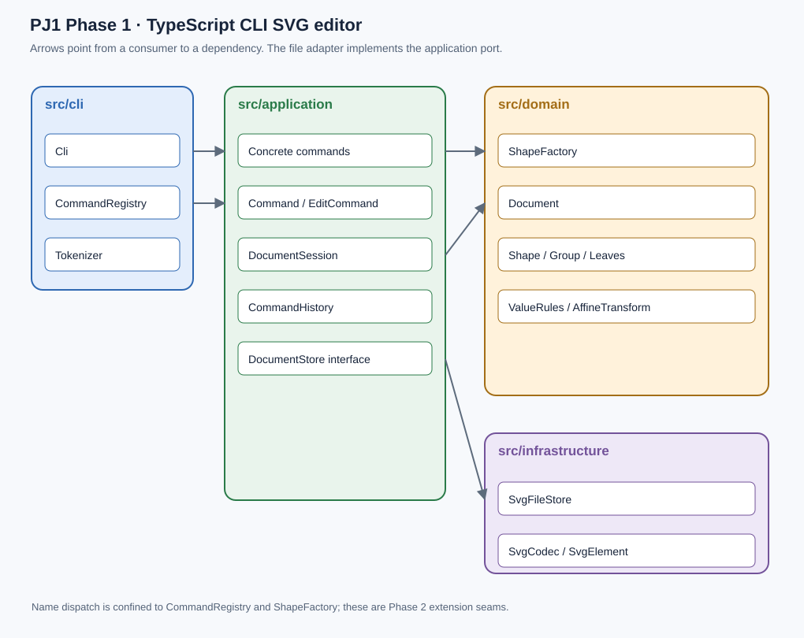

# PJ1 Phase 1 项目文档

## 架构方案

本版本依据用户提供的完整 `phase_cli_1.md`，并在用户确认后将早期 Python 摘要版修订为 TypeScript。运行环境为 Node.js 22+；使用 TypeScript 编译器、saxes XML 解析器。CLI 不依赖浏览器或外部图形编辑器。初始会话没有文档，必须先 `init` 或 `read`。

[PlantUML 组件图源码](architecture.puml) 可用于修改与重新渲染；上方 SVG 与它表达相同的模块和依赖关系。两处字符串名称映射仅出现在命令注册和图形工厂，已标为后续插件化重构点。图像为本地绘制的配套预览，PlantUML 源文件单独保留。

### 模块划分

| 模块 | 主要文件与职责 |
| --- | --- |
| `src/domain` | `Shape` 抽象类封装 ID、几何、样式与父节点；`Rect`、`Circle`、`Ellipse`、`Line`、`Text`、`Group` 一类一文件，各自实现移动、缩放、属性和 SVG 展示。`Document` 管理画布、寻址、层级、分组与绘制顺序；`ShapeFactory` 是唯一按图形类型注册的地方。 |
| `src/application` | `DocumentSession` 管理当前文档与路径；每条编辑用独立 Command 类；`CommandHistory` 调用 execute/undo/redo；`DocumentStore` 定义文件读写端口。 |
| `src/infrastructure` | `SvgCodec` 解析/序列化 SVG，`SvgElement` 只存放临时 XML 树；`SvgFileStore` 实现应用端口、UTF-8 与原子文件替换。 |
| `src/cli` | `Tokenizer` 解析引号、空白和整行注释；`CommandRegistry` 绑定协议、参数校验和 Command 构造；`Cli` 处理 `svg>` 提示符、错误输出与脚本模式。 |
| `src/main.ts` | 组合入口：将 CLI、会话和文件适配器装配起来，不承担编辑规则。 |
| `test` | Node 原生测试：领域、文件、命令、真实 CLI 子进程与静态架构检查。 |

文件名与生产类名一致；接口 `ShapeContainer` 单独放在同名文件。每个生产类保持私有或受保护的状态字段，不公开可随意修改的数据袋。`Group` 与叶子通过 `Shape` 抽象类统一处理 move/scale/set/delete；Group 的 move/scale 通过子节点多态递归实现。`Document` 的统一树同时决定 `tree`、SVG 绘制顺序及查找结果。

### 设计模式的选择与落地

**Command（课程要求）**：`Command` 定义 execute/undo/redo，`EditCommand` 在副本文档上执行修改，完整校验成功后发布新状态，并保存执行前后快照。`MoveCommand`、`GroupCommand`、`SetCommand` 等每一类编辑命令独立成类，一条编辑命令对应一个 undo 单元。`CommandHistory` 保有命令对象，而非 CLI 文本。新成功编辑清空 redo；失败操作不变更文档和历史。文档类命令和显示命令有单独的 `SessionCommand` 基类。文档操作成功后装入历史屏障，undo/redo 返回规定错误；下一次成功编辑恢复历史功能。

**Composite**：容器 `Group` 与叶子均继承 `Shape`；图形操作依赖同一接口，组递归处理子节点，支持嵌套、删除子树与直接 `in` 创建。将已存在图形移入组通过 `group` 或 `addto`。工厂只含六种内核类型，未来复合 `box` 尚未实现；因此目前对它返回 `unknown shape type`。

**Memento + Factory**：编辑命令保存多态文档克隆，避免为跨父容器分组、删除树及层级调整分别编写高风险逆操作。复杂度约为每条命令 O(N) 时间、历史 O(HN) 内存，上限 100 步。工厂负责类型名到构造器的绑定以及读回对象；当前两处名称映射是明示的 Phase 2 扩展插槽。

### 依赖方向规则

| 发起模块 | 允许依赖 | 理由 |
| --- | --- | --- |
| `domain` | 仅 `domain` | 核心模型不需要终端、文件系统或外部库。 |
| `application` | `application`、`domain` | Command 调用文档规则；借 `DocumentStore` 抽象文件操作，不导入实际文件实现。 |
| `infrastructure` | `infrastructure`、`application`、`domain` | 实现应用层端口，把 XML 转为核心对象；不被核心反向引用。 |
| `cli` | `cli`、`application`、`domain` | 解析用户输入并构造 Command；不处理 XML 或读写文件。 |
| `main.ts` | 所有层 | 唯一组合根，负责具体依赖注入。 |

禁止依赖从 `domain` 指向 `cli` 或 `infrastructure`，也禁止从 `application` 指向具体文件适配器。`test/architecture.test.ts` 使用 TypeScript AST 检查实际 import、类名和文件名、字段封装、switch 及图形类型分支；违反规则会导致测试失败。XML transform 函数名解析属于文件格式语法，不用于图形操作分派。

### 变化点假设

1. **新图形类型**：未来最可能出现 `box` 这类复合插件。当前只在 `ShapeFactory` 有图形名映射；内核图形对上层暴露相同接口，能够添加 Provider。真正动态插件加载不在 Phase 1 范围，故未增加空的插件框架。
2. **新命令及输入通道**：CLI 目前仅在 `CommandRegistry` 映射名称；若增加 GUI 或 agent 调用，可直接构造 Command，不修改图形核心。没有为本阶段建立网络接口，因为尚无实际需求。
3. **撤销策略与大文件**：快照可靠但耗内存，限制 100 步及最多 10000 个元素。若专业大文件成为目标，可以在 `EditCommand`/`CommandHistory` 的边界替换为差量历史；当前不提前牺牲易验证性。
4. **文件格式**：SVG 兼容范围可能扩大。`DocumentStore` 端口允许替换文件适配器，`SvgCodec` 集中处理读写；不支持的 SVG 标签会明确报错，不静默丢弃。

### 当前协议中的明确决策

课程规定显式、大小写敏感的 ID；create 和 group 必须由用户命名。读入外部 SVG 时，缺 ID 按标签名加序号填充并逐项打印 `warning:`。坐标按 SVG 像素坐标系：左上角为原点，x 向右、y 向下，支持浮点。移动和缩放直接修改图形几何属性；组递归作用于后代，不以 SVG transform 代替操作。导入文件已有 transform 时会保留供浏览器渲染，但命令作用于其包含的几何属性。

`group` 可从不同父容器收编对象。放置位置取原父容器的最低公共祖先，以及最早成员所在分支的位置；成员顺序按原文档遍历顺序确定。选择容器及其子孙会被拒绝。`front` 将元素放到同级最后绘制的位置，`back` 放到最先绘制的位置。`ungroup` 仅对非根级组有效，子图形提升至原组的位置；透明度不为 1 的导入组为避免改变合成外观会明确拒绝解组。`box` 及插件内结构属于下一阶段。

`set` 白名单为 fill/stroke/stroke-width、各类型规定的几何属性和 text 文本，不接受其他属性。额外的 SVG 呈现属性可从文件读入并保留，但不能通过本阶段 set 改动。尺寸及半径非负；scale 因子必须为正。文档操作 init/read/save/canvas 修改后 undo/redo 立即被禁止；无参数 canvas 查询不会影响历史。启动前没有文档时，其余命令返回 `no document. use 'init' or 'read' first`。

文件以 UTF-8 保存，允许 BOM 输入。只读写本阶段六类图形与嵌套 g；拒绝 path、image、use、样式表、外部资源、未实现的 box 等。旧 Python 版本支持的 polygon/polyline 不再作为内核图形。单文件最大 5 MiB、最多 10000 个图形及 128 层嵌套，避免异常输入消耗过多资源。默认画布尺寸 800×600。

## 过程记录

本节记录实际与 Codex 协作及修正，不把尚未发生的人工审阅算作事实。所有 Git 提交由工具以用户确认的 `zyy182` 与 GitHub 隐私邮箱创建，使用真实提交时间。

| 日期 | 决策与发现 | 修订及可核对结果 |
| --- | --- | --- |
| 2026-10-12 | 最初只拿到摘要；课程网址要求登录。用户当时确认 Python。 | 建立 Python 摘要版与 8 次分阶段提交，完成其 40 项测试，并打初始本地 `final` 标签。 |
| 2026-10-12 | 用户提供完整 `phase_cli_1.md`；发现明确要求 TypeScript、面向对象、Command 和另一套命令协议。 | 向用户说明差异，用户确认改用 TypeScript。记录逐项差异于 [requirement-audit.md](requirement-audit.md)，用 `python-summary-v1` 保存旧版标记，逐阶段迁移。 |
| 2026-10-12 | 第一阶段模型：判断通用数据 Node 与 tag 分支不符合要求。 | 改为 `Shape` + 六个封装类和 Group Composite；12 项领域测试通过。首次严格编译发现祖先查找的类型断言不安全，改为容器接口的 asShape。 |
| 2026-10-12 | 第二阶段文件：需要外部 SVG 缺 ID 警告与原子保存。 | 增加 `DocumentStore` 端口、XML 解析和文件适配器；累计 20 项测试通过。首次在带 pnpm 链接的目录生成 npm 锁文件，错误带入上游开发依赖；改到干净目录生成，只保留实际 5 个依赖包。 |
| 2026-10-12 | 第三阶段历史：初版快照方案可保留，但必须按 Command 落地及 IO 屏障。 | 每条命令独立类并保存 Memento，CommandHistory 运行 execute/undo/redo；累计 31 项测试通过。 |
| 2026-10-12 | 第四阶段终端：指定提示符、错误和完整课程会话。 | 实现位置参数、`in` 子句、`addto`、z-order 和 `tree [id]`；首轮发现 EOF 后重复提示与文件流错误重复打印，修复后 42 项测试通过。实际运行 6.1 流程图并保存 8 个元素。 |
| 2026-10-12 | 一致性核查：要求附图和明确依赖方向。 | 增加 PlantUML 源及配套可查看图，新增 3 项静态架构测试，累计 45 项通过。在线 PlantUML 渲染服务超时，因此配套 SVG 图本地绘制，图源继续保留。 |

原有 Python 代码只存在于旧 Git 提交和 `python-summary-v1`；当前工作树已移除。完整作业全文由用户提供，不能再沿用仅基于摘要的“符合要求”结论。

## 一致性自查

1. **模块划分是否与方案一致？** 当前 `src/domain`、`src/application`、`src/infrastructure`、`src/cli`、`src/main.ts` 与上方修订后的方案逐项对应。与最早的 Python 文档方案不一致的原因和迁移过程已记入 [修订记录](requirement-audit.md)。生产类一类一文件，接口单文件；旧版 Python 已从最终工作树移除。
2. **依赖方向是否被违反？** 静态检查解析所有生产 TypeScript 文件的实际 import，验证上述依赖矩阵；当前 45 项测试全部通过。`main.ts` 是明确允许跨层引用的组合根。图形操作不使用 `switch(tag)` 或按 shape.type 决定行为；类型名只在工厂中映射，命令名只在注册表中映射。其余依赖均在规则内。

实际 CLI 与原文对照：init/read/save/canvas/create/delete/move/scale/set/group/ungroup/addto/front/back/tree/show/help/undo/redo 均在帮助中列出；另外提供 `quit` 退出命令。CLI 写入操作有成功摘要、错误单行 `error:`；ID 唯一且大小写敏感。示例会话中两个预期错误与指定反馈已在真实子进程中验证。提交前用户仍应独立运行与讲解设计。

## 质量保证手段

严格编译：`npm run build`。自动化验收：`npm test`，目前 45 项通过。测试覆盖六种图形、Composite 递归、跨容器分组、防环、z-order、非根级解组、UTF-8 SVG 往返、自动补 ID 警告、文件错误、完整课程会话、失败编辑状态、历史屏障与架构依赖。真实子进程测试直接运行生成的 CLI，避免只测试内部函数。故障测试检查文件替换失败时原内容保留，编辑失败时文档、历史及路径保持原状态。

手工验收已运行 [流程图命令脚本](../examples/flowchart.commands)，导出 [SVG](../examples/flowchart.svg) 含 8 个元素。详细命令与结果见 [QA.md](QA.md)。不宣称通过课程隐藏测试或用户个人演示。实验环境为 macOS、Node.js 24.19.0；系统终端没有全局 Node.js，macOS 启动脚本使用已提供的本机运行环境。其他平台尚未实际执行。

代码和本地 `final` 标签完成最终验收后同步；私有仓库需要 GitHub Git 认证才能推送。远程代码与标签可访问性尚未验证，不能将本地完成写成已提交远程。截止时间为 2026-10-25 23:59。
